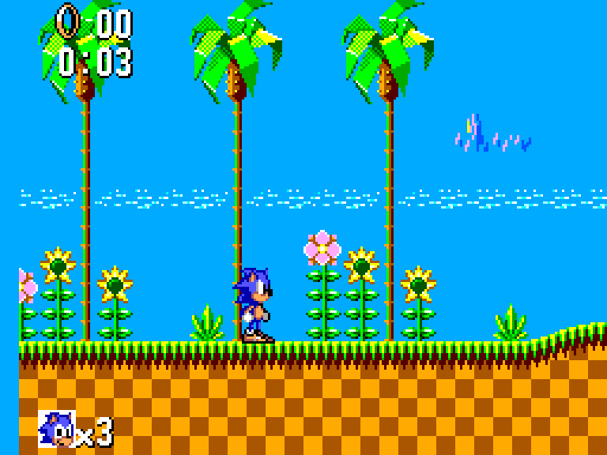
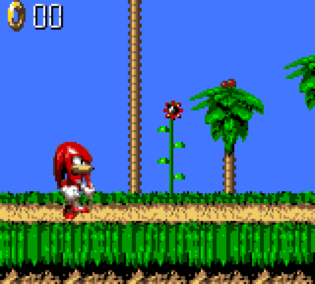

# SMS/GG Z80 Static Recompiler

A static recompiler that translates **Sega Master System** and **Game Gear**
Z80 ROM binaries into native C code, paired with a clean-room runner that
emulates the rest of the machine (VDP, SN76489 PSG, controller/system I/O,
mapper). One engine, both platforms — the Game Gear is the Master System with
a cropped viewport, a wider palette, and stereo sound (see PRINCIPLES.md #25).

This is **not** an emulator and **not** a hand-port: the game's Z80 machine
code becomes native C that runs directly; only the surrounding silicon is
modeled by the runtime.

> **Status: early (v0.0.4) — pre-release, expect bugs.** Two games are in
> bring-up: **Sonic the Hedgehog (SMS)** and **Sonic Blast (Game Gear)**. Across
> the title + attract-demo path exercised so far (~40–60s), both run with no
> interpreter-fallback dispatch miss (100% static) and have been validated
> across **7 accuracy axes** against **two independent accurate emulators**
> (Mesen 2 and Genesis Plus GX): VRAM/CRAM **byte-identical**, cycle timing
> jitter-only with no net drift, and audio aligned. Neither game has been played
> end to end, so full-gameplay coverage is unverified. See **[ACCURACY.md](ACCURACY.md)**
> for the precise claims, evidence, how-to-reproduce, and what's outstanding.
> Other SMS/GG Sonic titles are future targets.

| Sonic the Hedgehog (SMS) | Sonic Blast (Game Gear) |
|---|---|
|  |  |

*Recompiled native builds (no emulator), captured running the original ROMs.*

The [assisted coverage pass](COVERAGE.md) extends the original opening tests to
29 Sonic 1 routes and all 30 Sonic Blast act/character combinations, with zero
fallback on those routes. It also fixes live-bank dispatch and in-flight
fallback accounting, and centralizes game builds and ROM-bound QA controls.

## Headless capture

A game runner can record exactly what its window would show, with no window,
audio device or desktop input:

```text
Game.exe rom.sms --internal-scale 16 --input-script in.txt     --capture-out frames --capture-size 1920x1080 --capture-from 600 --capture-to 3299     --capture-every 1 --capture-wav out.wav --exit-at-frame 3300
```

- `--capture-out DIR` writes `frame_%06u.png` for 0-based frames `--capture-from`..`--capture-to`
  (every `--capture-every`). The GPU target (`--internal-scale`) or the cropped native
  framebuffer is aspect-fitted onto the `--capture-size` canvas; omit it for native size.
- `--capture-wav FILE` writes the mixed PSG output (`glue_audio_sample_rate()`, S16 stereo) for the
  same frame range; no audio device is opened.
- `--input-script FILE` takes `<frame> [P1:]BUTTONS` lines (`UP DOWN LEFT RIGHT A B C START`,
  joined by `+`, `-` releases). `A` is button 1, `B`/`C` button 2; `START` is the console Pause.
- The window is hidden and the run is unpaced. A one-line `[capture]` summary is printed on exit.

## Per-game runner repos

smsggrecomp is the shared framework. Each game lives in its own companion repo
that supplies the per-game `game.toml`, build glue, and a pre-built release. The
ROM and the generated C are **never** committed — you bring your own legally
dumped ROM and regenerate locally.

- **Sonic the Hedgehog (SMS)** —
  [mstan/SonicTheHedgehogSMSRecomp](https://github.com/mstan/SonicTheHedgehogSMSRecomp).
  Boots and plays Green Hill Zone; renders byte-exact to the oracle. Early.
- **Sonic Blast (Game Gear)** —
  [mstan/SonicBlastGGRecomp](https://github.com/mstan/SonicBlastGGRecomp).
  Boots through the intro to the title screen, byte-exact to the oracle. Early.

## Host-native execution and faithful internal resolution

Version 0.0.4 adds native instruction/dispatch/event jobs, exact PSG block
synthesis, direct ROM windows and shared immutable tile-row rendering jobs.
OpenGL draws those jobs at up to16x without a CPU enhanced framebuffer or
scale-dependent uploads. Original tile pixels are preserved: no smoothing or
invented detail. Both Sonic pilots pass the owner's visual checks and the
recorded per-game state, PCM, pixel and performance gates.

Game build scripts default to qualified O2/native execution. Use
`--window 3 --internal-scale 16` for faithful16x output. The ordinary native
SDL display and portable fallback remain available. Use `-ReferenceExecution`
for instruction diagnostics, `-ReferenceVDP` for the scalar renderer, or
`-PortableDisplay` for SDL-only output. See [the burndown record](docs/HOST_HLE_BURNDOWN.md).
The standalone Windows x64 `SmsRecomp.exe` is available in the engine release;
it translates supported owned cartridges to C and is not a game launcher.

## How it works

The recompiler (`recompiler/src/`) decodes every reachable Z80 instruction in
the ROM and emits equivalent C. Each Z80 subroutine becomes a C function
operating on a shared `Z80State` (AF, BC, DE, HL, IX, IY, SP, PC, the shadow
set, I/R, flags) and the same 64 KB address space + paged ROM as the original.
The state contract and verified instruction semantics come from the shared
[`z80-recomp-core`](https://github.com/mstan/z80-recomp-core) submodule, also
consumed by Sega Genesis Recomp's sound-CPU backend.
**The rest of the machine is not recompiled** — VDP rendering, the SN76489
PSG, controller/system ports, and the Sega/Codemasters mapper all run in the
runner. Same model as the sibling projects: recompile the CPU, emulate the
silicon. Computed jumps outside generated coverage stop with an explicit native
coverage error. Production play never enters an interpreter fallback.

Key pieces:
- **`z80_decoder.c`** — full Z80 ISA decode incl. the `CB`/`ED`/`DD`/`FD`/
  `DDCB`/`FDCB` prefix groups; classifies control flow (JP/JR/CALL/RET/RST/
  DJNZ) for the function finder. Semantics anchored to the vendored MIT
  `superzazu/z80.c`.
- **`code_generator.c`** — Z80 → C translation, one C function per
  subroutine, computed jumps routed through `call_by_address`, per-
  instruction T-state accumulation for line/frame timing.
- **[`FLAT_STEP.md`](FLAT_STEP.md)** — optional one-instruction-per-call
  output for hosts that use the Z80 as an interleaved coprocessor, including
  the Genesis sound CPU experiment.
- **`function_finder.c`** — static reachability from the reset/IRQ/NMI/RST
  vectors plus `[functions].extra` seeds and jump tables.

## What's in this repo

| Directory | Purpose |
|-----------|---------|
| `recompiler/src/` | The recompiler tool — analyzes the ROM, emits native C. Builds `SmsRecomp.exe`. |
| `runner/` | Shared native runtime: VDP, PSG adapter, I/O, mapper, SDL2 host and shared-service adapters. |
| `external/z80-recomp-core/` | Shared `Z80State`, generated host ABI, and verified instruction semantics. |
| `runner/include/` | Compatibility forwarding headers for existing generated SMS/GG source. |
| `runner/external/superzazu/` | Vendored MIT Z80 core — interpreter + codegen reference. |
| `tools/` | Platform-agnostic probes and the release packager. |
| `docs/` | Design notes. |
| _(per-game repos)_ | Each game has its own companion repo — see **Per-game runner repos** above. |

## Platform support

Targets **Windows (MSVC / MinGW)**, **macOS**, and **Linux**. SDL2 handles
windowing, rendering, audio, and gamepads.

## Building the recompiler

Clone recursively, or initialize the shared Z80 core before building:

```bash
git submodule update --init --recursive
```

```bash
cd recompiler
cmake -S . -B build -G "Visual Studio 17 2022" -A x64   # Windows
cmake --build build --config Release
# macOS/Linux:  cmake -S . -B build -G Ninja -DCMAKE_BUILD_TYPE=Release && ninja -C build
```

## Regenerating a game

From a game's companion repo checked out as a sibling of this engine:

```bash
# regenerate the native C from your own ROM:
../smsggrecomp/recompiler/build/SmsRecomp.exe sonicthehedgehog.sms --game game.toml
# overwrites generated/<prefix>_{full,dispatch,layout}.c, then rebuild the runner.
```

## Packaging a game release

`tools/package_game_release.ps1 -ProjectRoot <game repo>` builds
`release/<Game>-windows-x64.zip` from the game's `build/` output: the exe,
`SDL2.dll`, `Play.cmd` / `Play 16x.cmd`, `README.txt` (from the game's
`packaging/README.txt.in`), and every license notice under `licenses/` (game,
engine and z80-recomp-core `LICENSE` + `PERMISSIONS.md`, superzazu MIT, SDL2).
It refuses to package if any notice is missing and never includes a ROM or
generated C.

## ROMs

ROMs are **never** committed (`.gitignore`d), and neither is the generated C
(it is a derivative of the ROM). Drop a legally-obtained ROM into the game
directory and point `game.toml` at it. SMS ROMs are `.sms`, Game Gear `.gg`;
both are raw Z80 images with the `TMR SEGA` footer near the end of the first
32 KB.

## Acknowledgements

- **superzazu** — the vendored MIT Z80 interpreter (`runner/external/superzazu/`)
  serves as both the semantic reference for the recompiler and the oracle the
  generated code is validated against.

## License

PolyForm Noncommercial 1.0.0, with [additional permissions](PERMISSIONS.md)
for voluntary donations and advertising revenue. See [`LICENSE`](LICENSE) for
the standard license and [`PERMISSIONS.md`](PERMISSIONS.md) for the grant and
its conditions. Payment must not buy access to the software, games built with
it, or their updates, features, or game content, including early access.

Copyright © 2026 Matthew Stanley. Matthew Stanley has authority from the relevant
copyright holders to grant the additional permissions for smsggrecomp's project
code, as stated in [`PERMISSIONS.md`](PERMISSIONS.md). Licensing inquiries go to
him at <https://1379.tech>.

By contributing, you license your contribution under the project's
[PolyForm Noncommercial License 1.0.0](LICENSE), grant the
[additional permissions in `PERMISSIONS.md`](PERMISSIONS.md) for the rights you
control in your contribution, and authorize Matthew Stanley to grant those same
additional permissions for it.

Code in this repo is original except where noted in **Acknowledgements** above.
Third-party components keep their own terms: the vendored
`runner/external/superzazu/z80.c` is MIT (see
[its `LICENSE`](runner/external/superzazu/LICENSE)). The clean-room SN76489 PSG
is original to this project.

ROMs and console BIOS images remain copyrighted by their respective owners and
are not distributed; players supply them from their own collection. Generated C
is a machine translation of the ROM and is never committed. Release executables
contain statically recompiled builds of the original code, the same distribution
model used by other static recompilation projects such as N64: Recompiled.

---

<p align="center">
  <sub><b>R.A.I.D. — Retro AI Development</b> · a Discord for AI-assisted retro reverse-engineering, decomp &amp; recomp</sub>
</p>

<p align="center">
  <a href="https://discord.gg/Ad9BwSzctP"></a>
</p>
